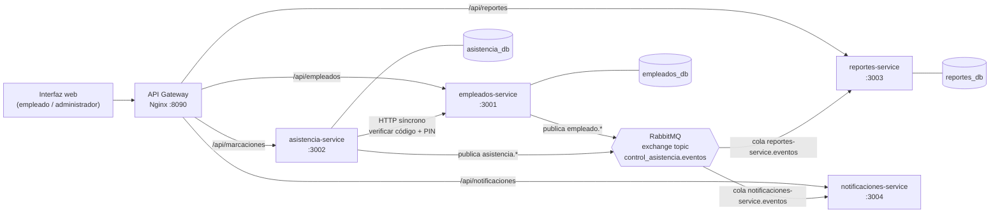
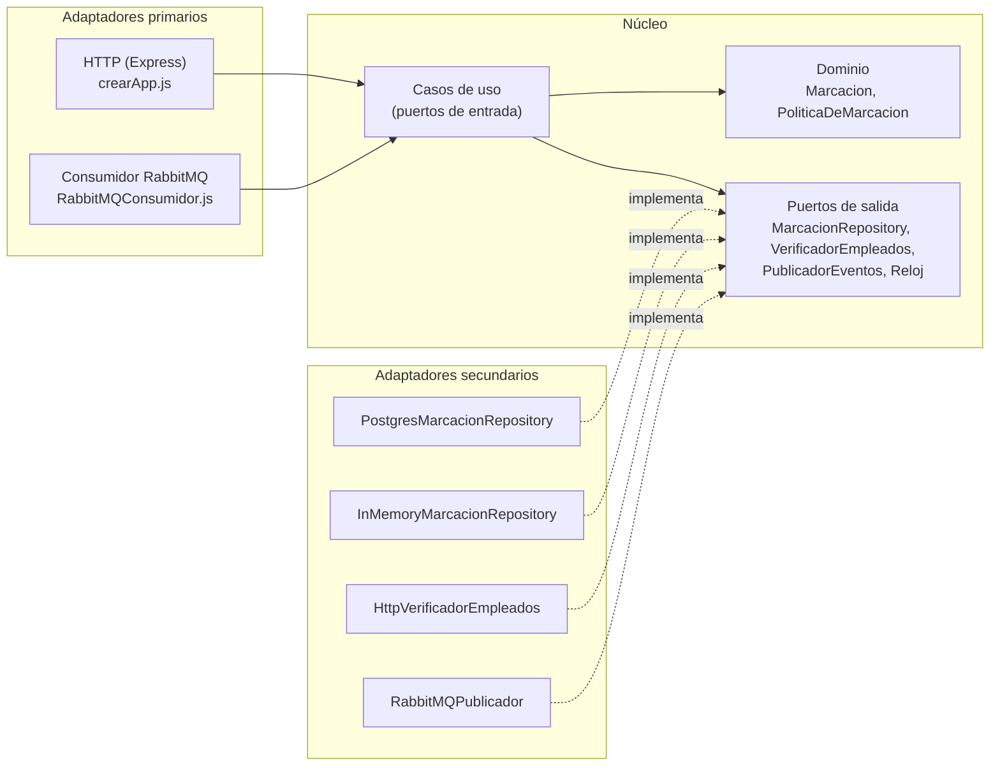
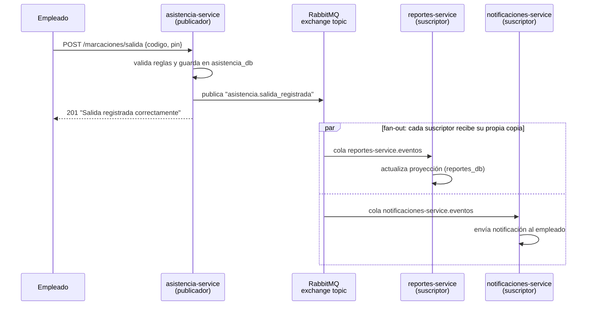

# Control de Entrada y Salida de Empleados

### Estructura y Arquitectura de Software — Patrones de arquitectura

Sistema para registrar la **entrada y salida de los empleados** de una oficina y para que el **administrador** gestione empleados, consulte movimientos por período y genere reportes de horas.

El proyecto implementa y documenta **cuatro patrones de arquitectura**:

| # | Patrón | Dónde se ve |
|---|--------|-------------|
| 1 | **Microservicios** | 4 servicios independientes en `services/`, cada uno con su Dockerfile, puerto y base de datos |
| 2 | **Arquitectura Hexagonal (Puertos y Adaptadores)** | Cada servicio dividido en `domain/` → `application/` (puertos) → `infrastructure/` (adaptadores) |
| 3 | **Publicador–Suscriptor** | RabbitMQ: `empleados` y `asistencia` publican eventos; `reportes` y `notificaciones` se suscriben |
| 4 | **Inyección de Dependencias** | `src/container.js` de cada servicio (Composition Root) + constructores de los casos de uso |

**Tecnologías:** Node.js 20 · Express · PostgreSQL 16 · RabbitMQ 3.13 · Nginx · Docker Compose.

---

## Tabla de contenido

1. [Ejecución rápida](#1-ejecución-rápida)
2. [Arquitectura general](#2-arquitectura-general)
3. [Patrón 1: Microservicios](#3-patrón-1-microservicios)
4. [Patrón 2: Arquitectura Hexagonal](#4-patrón-2-arquitectura-hexagonal-puertos-y-adaptadores)
5. [Patrón 3: Publicador–Suscriptor](#5-patrón-3-publicadorsuscriptor)
6. [Patrón 4: Inyección de Dependencias](#6-patrón-4-inyección-de-dependencias)
7. [Caso de uso: flujos básicos y alternos](#7-caso-de-uso-flujos-básicos-y-alternos)
8. [Guion de demostración](#8-guion-de-demostración-socialización)
9. [API REST](#9-api-rest)
10. [Pruebas unitarias](#10-pruebas-unitarias)
11. [Estructura del repositorio](#11-estructura-del-repositorio)
12. [Solución de problemas](#12-solución-de-problemas)

---

## 1. Ejecución rápida

**Requisito:** [Docker Desktop](https://www.docker.com/products/docker-desktop/) (incluye Docker Compose).

```bash
git clone https://github.com/lenimsmith18/estructura-y-arquitectura-de-software.git
cd estructura-y-arquitectura-de-software
docker compose up --build
```

La primera vez tarda unos minutos (descarga imágenes). Cuando en la consola aparezca
`asistencia-service escuchando en http://localhost:3002`, abra:

| Qué | URL |
|-----|-----|
| **Aplicación web** (empleado y administrador) | http://localhost:8090 |
| Consola de RabbitMQ (ver colas y mensajes) — usuario `guest`, clave `guest` | http://localhost:15672 |

**Datos de prueba** (se crean automáticamente):

| Código | PIN | Nombre | Estado |
|--------|-----|--------|--------|
| `E001` | `1234` | Ana Gómez | Activo |
| `E002` | `1234` | Carlos Pérez | Activo |
| `E003` | `1234` | Laura Ríos | **Inactivo** (para probar ese flujo alterno) |

Para detener: `Ctrl + C` y luego `docker compose down`.
Para borrar también la base de datos: `docker compose down -v`.

> También existen atajos con npm en la raíz: `npm start` (= `docker compose up --build`), `npm stop`, `npm run reset` y `npm test`.

---

## 2. Arquitectura general



El documento del caso de uso pide "una interfaz para los empleados, un módulo de administración, un servidor que procesa las solicitudes y una base de datos". Así se refleja cada parte:

- **Interfaz:** `gateway/public/index.html`, con la pestaña *Empleado* (kiosco de marcación) y la pestaña *Administrador*.
- **Servidor:** los cuatro microservicios detrás del API Gateway.
- **Base de datos:** PostgreSQL, con una base distinta por microservicio.

---

## 3. Patrón 1: Microservicios

El sistema se divide por **capacidades de negocio** (bounded contexts). Cada microservicio:

- es un **proceso independiente** con su propio `package.json`, `Dockerfile` y puerto;
- es **dueño exclusivo de sus datos** (*database per service*); ningún servicio lee la base de otro;
- se comunica con los demás solo mediante **API HTTP** o **eventos**;
- se puede desplegar, escalar o caer sin derribar a los demás.

| Microservicio | Responsabilidad | Base de datos | Publica | Se suscribe a |
|---|---|---|---|---|
| `empleados-service` | Administrar empleados; verificar identidad (código + PIN) | `empleados_db` | `empleado.registrado`, `empleado.actualizado` | — |
| `asistencia-service` | Registrar entradas y salidas aplicando las reglas del negocio | `asistencia_db` | `asistencia.entrada_registrada`, `asistencia.salida_registrada` | — |
| `reportes-service` | Consultar movimientos por período y generar el reporte de horas | `reportes_db` (proyección construida con eventos) | — | `empleado.*`, `asistencia.*` |
| `notificaciones-service` | Avisar al empleado cada vez que marca | memoria | — | `asistencia.*`, `empleado.registrado` |

**Comunicación entre servicios:**

- **Síncrona (HTTP).** `asistencia-service` le pregunta a `empleados-service` si el código y el PIN son válidos y si el empleado está activo, en `services/asistencia-service/src/infrastructure/clients/HttpVerificadorEmpleados.js`. Se eligió una llamada síncrona porque la autorización tiene que ser inmediata: si el administrador desactiva a un empleado, la siguiente marcación de ese empleado ya debe rechazarse.
- **Asíncrona (eventos).** Todo lo demás pasa por RabbitMQ (ver patrón 3).

**API Gateway** (`gateway/nginx.conf`): es el único punto de entrada para la interfaz y enruta cada `/api/<recurso>` al servicio dueño. También **bloquea** el endpoint interno `/empleados/verificacion`, que solo debe usar otro microservicio.

**Evidencia en la demo:** ejecute `docker compose stop reportes-service`. Los empleados pueden seguir marcando entrada y salida. Al volver a levantarlo (`docker compose start reportes-service`), procesa los eventos que quedaron en su cola de RabbitMQ y se pone al día.

> *Simplificación consciente:* para que la demo sea liviana, las tres bases de datos viven en **un mismo servidor PostgreSQL** (`infra/postgres/init.sql`), pero son bases separadas y cada servicio usa solo la suya. En producción cada una podría estar en un servidor distinto sin cambiar el código: basta con cambiar `DATABASE_URL`.

---

## 4. Patrón 2: Arquitectura Hexagonal (Puertos y Adaptadores)

Los cuatro microservicios usan la misma organización interna:

```
src/
├── domain/                  ← CENTRO del hexágono: entidades y reglas de negocio puras.
│                              No importa Express, pg, amqplib… solo JavaScript.
├── application/
│   ├── ports/               ← PUERTOS DE SALIDA: contratos (clases abstractas) que el
│   │                          núcleo necesita: repositorios, publicador de eventos, reloj…
│   └── use-cases/           ← PUERTOS DE ENTRADA: los casos de uso que el exterior invoca.
├── infrastructure/          ← ADAPTADORES: el único lugar con tecnología concreta.
│   ├── http/                ← adaptador PRIMARIO (driving): Express → caso de uso
│   ├── messaging/           ← RabbitMQ: publicador (secundario) o consumidor (primario)
│   ├── persistence/         ← adaptadores SECUNDARIOS (driven): PostgreSQL y en memoria
│   └── clients/ security/ notifications/
├── container.js             ← Inyección de dependencias: conecta adaptadores con puertos
└── main.js                  ← arranque del proceso
```

**Regla de dependencias:** `infrastructure → application → domain`. Nunca al revés. El dominio no sabe que existen HTTP, SQL o RabbitMQ.



**Ejemplo concreto (asistencia-service):**

| Pieza | Archivo |
|---|---|
| Regla "no se permite entrada duplicada / salida sin entrada" | `domain/PoliticaDeMarcacion.js` |
| Entidad | `domain/Marcacion.js` |
| Puerto de salida | `application/ports/MarcacionRepository.js` |
| Adaptador PostgreSQL de ese puerto | `infrastructure/persistence/PostgresMarcacionRepository.js` |
| Adaptador en memoria del **mismo** puerto | `infrastructure/persistence/InMemoryMarcacionRepository.js` |
| Puerto para verificar empleados (otro microservicio) | `application/ports/VerificadorEmpleados.js` |
| Adaptadores de ese puerto | `infrastructure/clients/HttpVerificadorEmpleados.js` y `VerificadorEnMemoria.js` |
| Caso de uso (puerto de entrada) | `application/use-cases/RegistrarEntrada.js` |
| Adaptador primario HTTP | `infrastructure/http/crearApp.js` |

**Evidencia:** un mismo núcleo funciona con PostgreSQL o en memoria sin cambiar una sola línea del dominio. Basta con cambiar `REPOSITORIO=postgres|memoria`. Las pruebas unitarias ejecutan todos los casos de uso **sin base de datos, sin RabbitMQ y sin servidor HTTP**.

El caso de uso dice que la identificación puede ser "un código de empleado, usuario y contraseña, una tarjeta o incluso algún sistema biométrico". En este diseño eso se resuelve con **un adaptador nuevo** de los puertos `HasherPin` / `VerificadorEmpleados`, sin tocar el dominio.

---

## 5. Patrón 3: Publicador–Suscriptor

Se implementa con **RabbitMQ**, usando un *exchange* de tipo `topic` llamado `control_asistencia.eventos`.



**Características que se ven en el código:**

- **Desacoplamiento.** El publicador (`RabbitMQPublicador.js`) solo conoce el exchange y la *routing key*, y no sabe quién escucha. `notificaciones-service` se agregó **sin modificar** `asistencia-service`.
- **Fan-out.** Cada suscriptor declara **su propia cola durable** y la enlaza con patrones (`RabbitMQConsumidor.js`):
  - `reportes-service.eventos` ← `empleado.*`, `asistencia.*`
  - `notificaciones-service.eventos` ← `asistencia.*`, `empleado.registrado`
- **Asincronía.** El empleado recibe la confirmación sin esperar a que se generen los reportes ni las notificaciones.
- **Tolerancia a fallos.** Si un suscriptor está caído, sus mensajes **se acumulan en su cola** y se procesan cuando vuelve (`ack` manual).
- **Idempotencia.** Si un evento llega dos veces, `reportes-service` no lo duplica (`ON CONFLICT DO NOTHING`).

**Catálogo de eventos** (sobre común: `{ id, tipo, ocurridoEn, origen, datos }`):

| Evento (routing key) | Publicador | Datos | Suscriptores |
|---|---|---|---|
| `empleado.registrado` | empleados | id, codigo, nombre, cargo, activo | reportes, notificaciones |
| `empleado.actualizado` | empleados | id, codigo, nombre, cargo, activo | reportes |
| `asistencia.entrada_registrada` | asistencia | marcación (empleado, fechaHora) | reportes, notificaciones |
| `asistencia.salida_registrada` | asistencia | marcación + `entradaId`, `duracionMinutos` | reportes, notificaciones |

**Para verlo en vivo**, abra http://localhost:15672 → *Exchanges* → `control_asistencia.eventos` → *Bindings*. Los logs muestran `[evento publicado]` y `[evento recibido]` con `docker compose logs -f reportes-service notificaciones-service`.

---

## 6. Patrón 4: Inyección de Dependencias

Los casos de uso **no crean** sus dependencias: las **reciben por constructor** y dependen solo de los **puertos** (abstracciones), nunca de clases concretas.

```js
// services/asistencia-service/src/application/use-cases/RegistrarEntrada.js
class RegistrarEntrada {
  constructor({ verificadorEmpleados, marcacionRepository, publicadorEventos, reloj }) {
    this.verificadorEmpleados = verificadorEmpleados;   // puerto, no "HttpVerificadorEmpleados"
    this.marcacionRepository = marcacionRepository;     // puerto, no "PostgresMarcacionRepository"
    ...
  }
}
```

Todos los objetos se crean y conectan en un **único lugar** por servicio, el *Composition Root*, que es el archivo `src/container.js`:

```js
// services/asistencia-service/src/container.js (resumen)
const marcacionRepository = config.repositorio === 'postgres'
  ? new PostgresMarcacionRepository(pool)
  : new InMemoryMarcacionRepository();

const verificadorEmpleados = config.verificador === 'http'
  ? new HttpVerificadorEmpleados({ urlBase: config.empleadosUrl })
  : new VerificadorEnMemoria();

const deps = { verificadorEmpleados, marcacionRepository, publicadorEventos, reloj };
const registrarEntrada = new RegistrarEntrada(deps);   // ← inyección por constructor
```

**Beneficios que se demuestran:**

- **Configuración sin tocar código.** Las variables `REPOSITORIO`, `BROKER` y `VERIFICADOR` deciden qué adaptador se inyecta.
- **Pruebas.** En `test/asistencia.test.js` se inyecta un `RelojFalso` para "adelantar" 8,5 horas y comprobar el cálculo de la jornada. También se inyecta un verificador con `disponible = false` para simular el error de conexión.
- La cadena es la misma en los cuatro servicios: los **adaptadores HTTP y de mensajería** reciben los casos de uso ya construidos, y los casos de uso reciben los adaptadores de salida.

---

## 7. Caso de uso: flujos básicos y alternos

| Flujo del documento | Dónde se implementa | Respuesta |
|---|---|---|
| **Registro de entrada** | `RegistrarEntrada.js` + `PoliticaDeMarcacion.crearEntrada` | `201` "Entrada registrada correctamente" |
| **Registro de salida** (consulta la última entrada y calcula la jornada) | `RegistrarSalida.js` + `PoliticaDeMarcacion.crearSalida` | `201` "Salida registrada… Jornada de X h Y min" |
| Empleado no registrado (o PIN incorrecto) | `identificarEmpleado.js` → `EmpleadoNoIdentificado` | `401` "No fue posible identificar al usuario" |
| Usuario inactivo | `identificarEmpleado.js` → `EmpleadoInactivo` | `403` "…comuníquese con el administrador" |
| Entrada duplicada | `PoliticaDeMarcacion.crearEntrada` → `EntradaDuplicada` | `409` "Ya existe una entrada abierta…" |
| Salida sin entrada | `PoliticaDeMarcacion.crearSalida` → `SalidaSinEntrada` | `409` "No existe una entrada previa abierta…" |
| Error de conexión (servidor o BD) | `HttpVerificadorEmpleados`, `postgres.js#traducirError`, `nginx.conf` | `503` "La operación no pudo ser procesada…" |
| Administrador: registrar y administrar empleados | `empleados-service`: `RegistrarEmpleado`, `ActualizarEmpleado` | — |
| Administrador: consultar movimientos por período | `reportes-service`: `ConsultarMovimientos` + `Periodo` | — |
| Administrador: generar reportes | `reportes-service`: `GenerarReporteHoras` + `ReporteDeHoras` | — |

---

## 8. Guion de demostración (socialización)

Con `docker compose up --build` en ejecución, abra http://localhost:8090.

1. **Pestaña Empleado.** Ingrese `E001` / `1234` y pulse **Registrar entrada** (mensaje verde).
2. Pulse **Registrar entrada** otra vez. Aparece el aviso de *entrada duplicada*.
3. Pulse **Registrar salida**. Se muestra la duración de la jornada.
4. Pruebe `E003` / `1234` (*usuario inactivo*) y `X999` / `1234` (*empleado no registrado*).
5. **Pestaña Administrador.** Registre el empleado `E004`. En *Notificaciones enviadas* aparece la bienvenida, que llegó por un evento.
6. Desactive a `E002` y luego intente marcar con `E002`. Queda rechazado al instante, gracias a la verificación HTTP síncrona.
7. Pulse **Consultar movimientos** y **Reporte de horas**. Estos datos los construyó `reportes-service` solo a partir de eventos.
8. **Tolerancia a fallos** (en otra terminal):
   ```bash
   docker compose stop reportes-service     # marque entradas/salidas: siguen funcionando
   docker compose start reportes-service    # procesa los eventos pendientes de su cola
   docker compose stop empleados-service    # al marcar: 503 "La operación no pudo ser procesada"
   docker compose start empleados-service
   ```
9. **RabbitMQ.** En http://localhost:15672 → *Queues* se ven las dos colas y los mensajes.
10. **Logs**, para ver el pub/sub en acción:
    ```bash
    docker compose logs -f asistencia-service reportes-service notificaciones-service
    ```

---

## 9. API REST

A través del gateway (`http://localhost:8090/api/...`), o directo a cada servicio (`http://localhost:300X/...`).

| Método | Ruta (gateway) | Servicio | Descripción |
|---|---|---|---|
| `GET` | `/api/empleados` | empleados | Listar empleados |
| `POST` | `/api/empleados` | empleados | Registrar `{codigo, nombre, cargo, pin}` |
| `GET` | `/api/empleados/:id` | empleados | Obtener un empleado |
| `PATCH` | `/api/empleados/:id` | empleados | Actualizar `{nombre?, cargo?, activo?}` |
| `POST` | `/empleados/verificacion` (solo interno, puerto 3001) | empleados | Verificar `{codigo, pin}` |
| `POST` | `/api/marcaciones/entrada` | asistencia | Registrar entrada `{codigo, pin}` |
| `POST` | `/api/marcaciones/salida` | asistencia | Registrar salida `{codigo, pin}` |
| `POST` | `/api/marcaciones/mias` | asistencia | Últimas 10 marcaciones del empleado `{codigo, pin}` |
| `GET` | `/api/reportes/movimientos?desde=AAAA-MM-DD&hasta=AAAA-MM-DD&empleado=E001` | reportes | Movimientos del período |
| `GET` | `/api/reportes/horas?desde=AAAA-MM-DD&hasta=AAAA-MM-DD` | reportes | Horas trabajadas por empleado |
| `GET` | `/api/notificaciones?limite=20` | notificaciones | Últimas notificaciones enviadas |
| `GET` | `/health` (en cada puerto 3001–3004) | todos | Estado del servicio |

Ejemplos con `curl` (Git Bash, Linux o macOS; en PowerShell use `curl.exe`):

```bash
curl -X POST http://localhost:8090/api/marcaciones/entrada -H "Content-Type: application/json" -d '{"codigo":"E001","pin":"1234"}'
curl -X POST http://localhost:8090/api/marcaciones/salida  -H "Content-Type: application/json" -d '{"codigo":"E001","pin":"1234"}'
curl "http://localhost:8090/api/reportes/horas?desde=2026-10-01&hasta=2026-10-31"
```

---

## 10. Pruebas unitarias

Se ejecutan **sin Docker**, porque gracias a la inyección de dependencias usan adaptadores en memoria. Requieren Node.js 20 o superior.

```bash
npm test
```

| Servicio | Pruebas | Qué cubren |
|---|---|---|
| empleados | 4 | registro y evento publicado, código duplicado, validación del PIN, verificación (autorizado / PIN incorrecto / inexistente / inactivo) |
| asistencia | 6 | flujo básico (entrada y salida, 8 h 30 min) y los **5 flujos alternos** |
| reportes | 4 | movimientos por período, reporte de horas, idempotencia, validación del período |
| notificaciones | 2 | notificación de salida y eventos ignorados |

**Ejecutar un servicio sin Docker (opcional).** Cada servicio arranca solo, en modo memoria:

```bash
cd services/asistencia-service
npm install
npm start          # REPOSITORIO=memoria, BROKER=memoria, VERIFICADOR=memoria por defecto
```

---

## 11. Estructura del repositorio

```
.
├── docker-compose.yml          # Orquesta: postgres, rabbitmq, 4 microservicios, gateway
├── package.json                # Atajos: npm start | stop | reset | test
├── gateway/
│   ├── nginx.conf              # API Gateway (enrutamiento + bloqueo de endpoint interno)
│   └── public/index.html       # Interfaz web (empleado + administrador)
├── infra/postgres/init.sql     # Crea una base de datos por microservicio
└── services/
    ├── empleados-service/
    │   ├── Dockerfile
    │   ├── src/
    │   │   ├── domain/                 Empleado.js, errores.js
    │   │   ├── application/ports/      EmpleadoRepository, PublicadorEventos, HasherPin
    │   │   ├── application/use-cases/  RegistrarEmpleado, ActualizarEmpleado, ConsultarEmpleados, VerificarIdentidad
    │   │   ├── infrastructure/         http/, persistence/, messaging/, security/
    │   │   ├── container.js            ← Inyección de dependencias
    │   │   └── main.js
    │   └── test/
    ├── asistencia-service/             (misma estructura; + clients/HttpVerificadorEmpleados)
    ├── reportes-service/               (misma estructura; + messaging/RabbitMQConsumidor)
    └── notificaciones-service/         (misma estructura; + notifications/ConsolaNotificador)
```

---

## 12. Solución de problemas

| Problema | Solución |
|---|---|
| `port is already allocated` en 8090 | Use otro puerto: `GATEWAY_PORT=9090 docker compose up --build` (PowerShell: `$env:GATEWAY_PORT=9090; docker compose up --build`) |
| Puerto 3001–3004, 5672 o 15672 ocupado | Detenga el programa que lo usa o cambie el puerto izquierdo en `docker-compose.yml` |
| La web muestra "no fue posible comunicarse con el servidor" justo al arrancar | Espere unos segundos a que todos los servicios estén `healthy` (`docker compose ps`) |
| Quiere empezar con datos limpios | `docker compose down -v` y de nuevo `docker compose up --build` |

**Posibles mejoras** (fuera del alcance académico): autenticación del administrador (JWT), patrón *Outbox* para garantizar la publicación de eventos si el broker cae justo después de guardar, y una base de datos en un servidor separado por microservicio.
